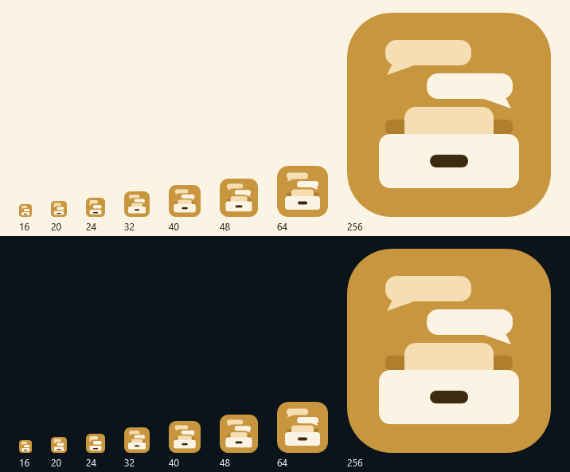
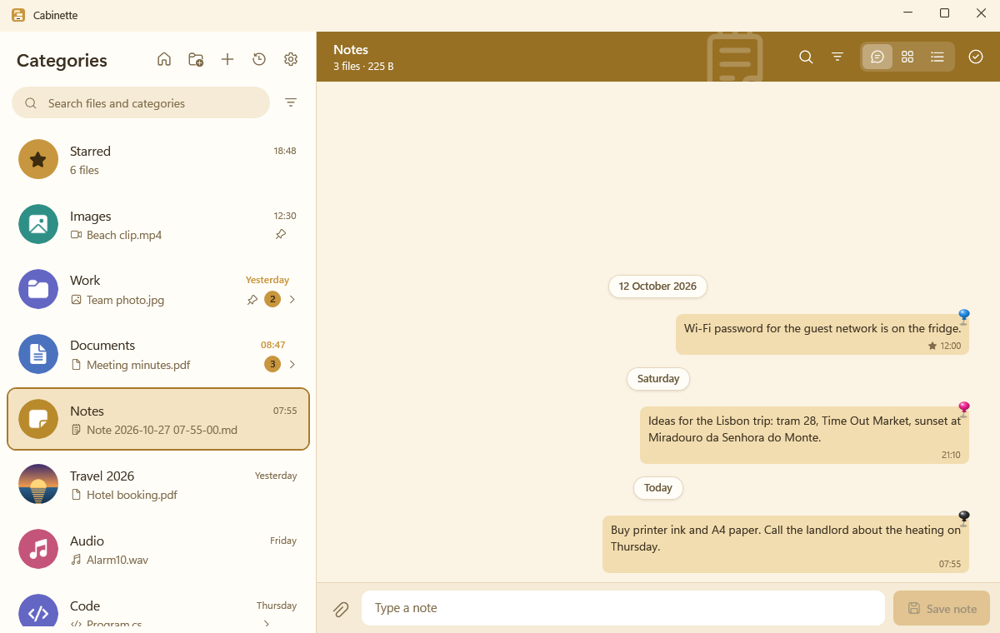
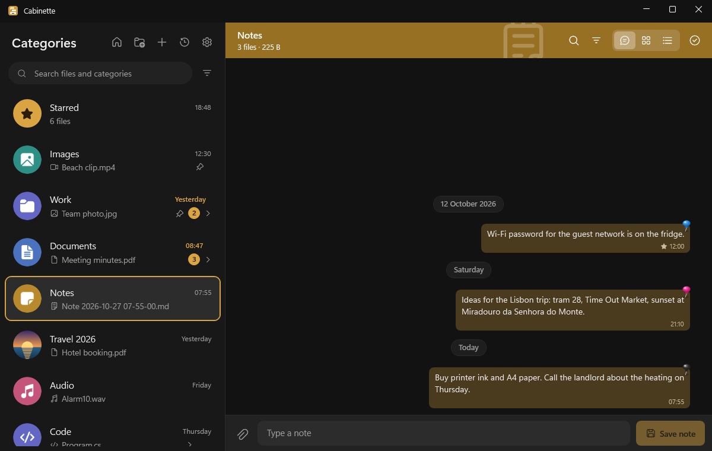
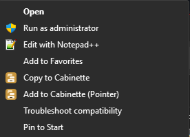
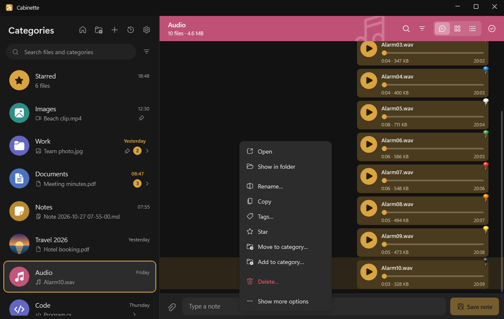
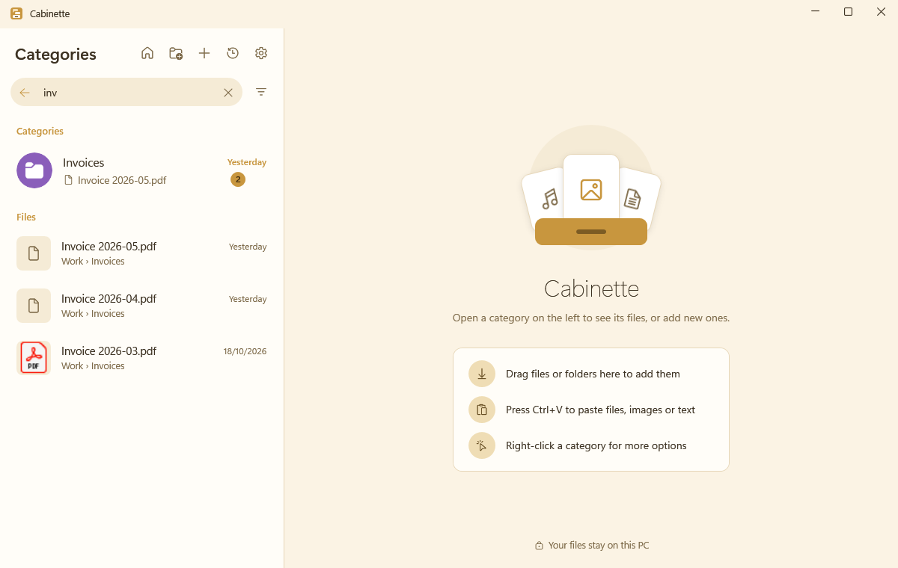
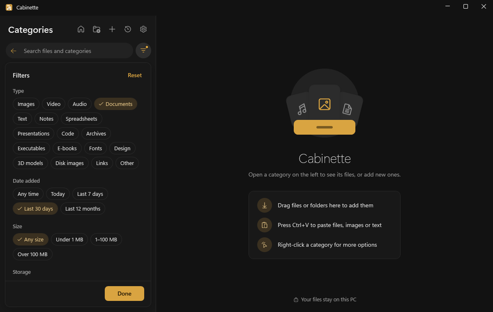
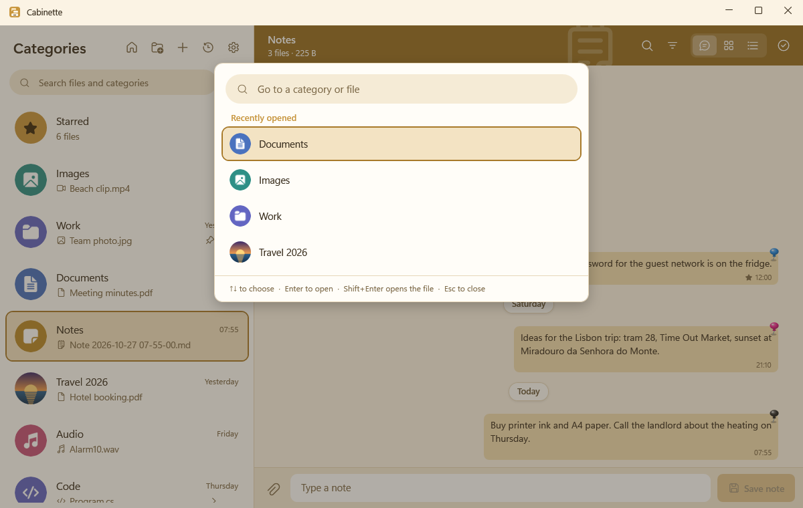
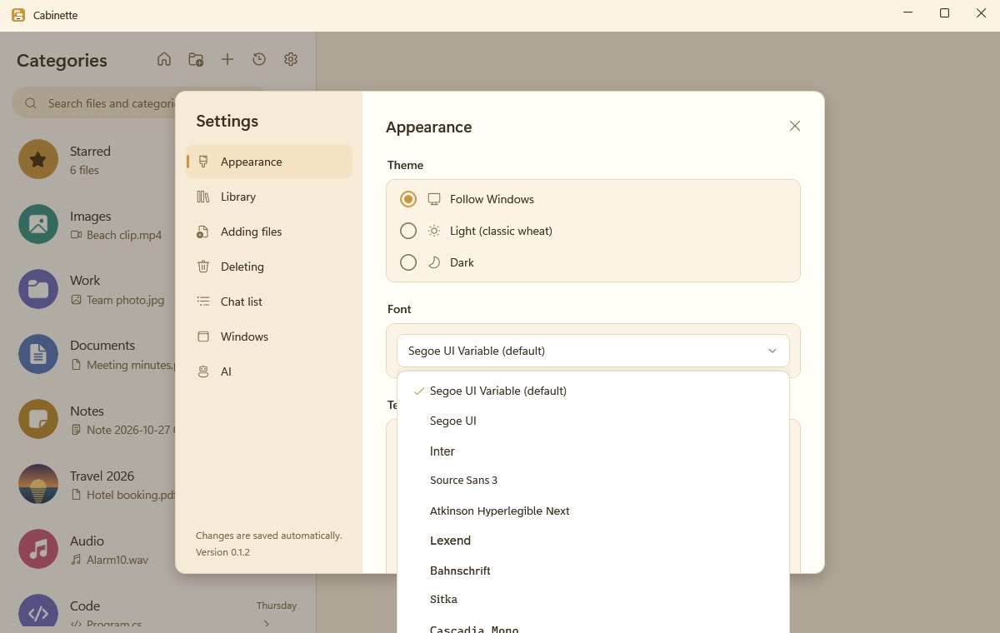
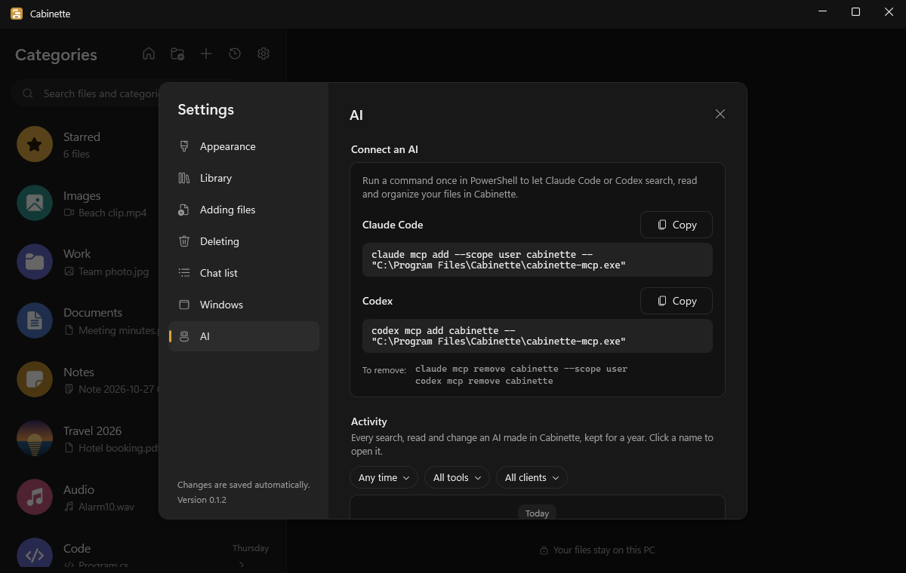

<p align="center"></p>

<h1 align="center">Cabinette</h1>

<p align="center">
  A personal file organizer for Windows, laid out like a chat app.<br>
  Categories sit in a list on the left, like chats. Opening one shows its files as a thread of bubbles, newest at the bottom.
</p>

<p align="center">
  <b>Windows 10 and 11 (x64)</b> · <b>.NET 10, WPF</b> · <b>GPL-3.0</b> · <b>Version 0.1.4</b>
</p>

<p align="center">
  
  
</p>

---

## Contents

- [The idea](#the-idea)
- [Features at a glance](#features-at-a-glance)
- [Install](#install)
- [First run](#first-run)
- [Core ideas: the vault, copies and pointers](#core-ideas-the-vault-copies-and-pointers)
- [Categories](#categories)
- [Adding files](#adding-files)
- [The Explorer menu](#the-explorer-menu)
- [Threads: Chat, Grid, Gallery and Details](#threads-chat-grid-gallery-and-details)
- [Working with files](#working-with-files)
- [Search, tags and filters](#search-tags-and-filters)
- [Quick switcher (Ctrl+K)](#quick-switcher-ctrlk)
- [Starred files](#starred-files)
- [Clean My Downloads mode](#clean-my-downloads-mode)
- [The vault monitor and the tray](#the-vault-monitor-and-the-tray)
- [Vault tools: move, migrate, back up, restore](#vault-tools-move-migrate-back-up-restore)
- [Appearance](#appearance)
- [Settings reference](#settings-reference)
- [Keyboard shortcuts](#keyboard-shortcuts)
- [Use Cabinette from Claude Code or Codex](#use-cabinette-from-claude-code-or-codex)
- [Where your data lives](#where-your-data-lives)
- [Uninstall](#uninstall)
- [Troubleshooting](#troubleshooting)
- [Build from source](#build-from-source)
- [Project layout](#project-layout)
- [Project status](#project-status)
- [License](#license)

---

## The idea

Most of us keep files the way a chat keeps messages: something arrives, it's needed for a while, and later you scroll back to find it. Cabinette organizes files that way.

- Every **category** (Images, Documents, Invoices, Travel 2026…) is a chat in the list on the left. The category with the newest file rises to the top, and unread badges count files that arrived without you.
- Opening a category shows its files as a **thread**: bubbles under "Today", "Yesterday" and "Monday" headers, with real thumbnails, inline audio players and the first lines of notes.
- Files live in a **vault**, a normal folder you choose, with one subfolder per category. Cabinette keeps the folders and its library in sync both ways, so the vault stays usable from Explorer.
- Everything stays on your PC. Cabinette itself makes no network connections.

## Features at a glance

- **Categories as threads.** Audio, Images, Documents, Code and more are built in, with subcategories (Code › Python, Documents › PDF and so on). Create, rename, delete, pin and re-icon any of them, built-in ones included.
- **Two ways to keep a file.** *Copy* puts a copy in your vault and leaves the original where it was. *Pointer* leaves the file where it is and only links to it.
- **Four views.** Chat bubbles with date headers, a thumbnail grid, a photo **Gallery** for Images (with "date taken") and a sortable details list. Thumbnails are Windows' own; audio plays inline and video in a built-in viewer.
- **Many ways in.** Drag and drop, the + button, the paperclip, Ctrl+V (pasted text, images and links become files), notes typed into the message box, and the Explorer right-click menu.
- **Sorted for you.** Files go to the category for their type. In a type category (Images, Spreadsheets, Code › Java…), files of another known type go to their own category, so a photo dropped on Spreadsheets lands in Images. Your own categories keep whatever you drop.
- **Duplicates caught.** Every file is hashed. Identical content is stored once, and a notice tells you where it already is.
- **Real Windows right-click menu** on every file (Open with, Send to, 7-Zip and so on), next to Cabinette's own actions.
- **Search everything.** Category and file names across the whole library, `#tags` combined with text, and filters by type, date, size, mode, extension or missing files.
- **Ctrl+K quick switcher** to jump to any category or file in a few keystrokes.
- **Starred files** gathered in one row at the top of the list.
- **Clean My Downloads mode** (off by default): new downloads move into your vault, sorted by type, a minute after they finish. The originals go to the Recycle Bin, never deleted permanently.
- **A vault that stays in sync.** A tray icon watches the vault: files you add, rename, move or delete in Explorer show up in Cabinette, with grouped notifications.
- **Vault tools.** Move the vault, copy pointer files into it, and back up or restore everything as a single `.zip`, also on another PC.
- **Comfortable to read.** Light (warm wheat) and dark (graphite) themes with a gold accent, ten fonts, four text sizes and a Bold text switch.
- **Playful drag and drop.** Drop zones spring in, an upload ring fills after a drop, and categories glide to the top as files arrive. If Windows' animation effects are off, so are these.
- **Claude Code and Codex.** They can search, read and organize your library through Cabinette's MCP server, and an activity log shows everything they did.

## Install

1. Download `Cabinette-Setup.exe` from the [Releases page](https://github.com/alperkizil/Cabinette/releases), or [build it yourself](#build-the-installer).
2. Run it. Cabinette isn't code-signed, so Windows SmartScreen shows "unknown publisher" the first time: choose **More info → Run anyway**.
3. If the .NET 10 Desktop Runtime is missing, setup downloads the latest 10.x from Microsoft (about 60 MB) and installs it quietly. The download only runs if it carries a valid Microsoft signature.

**Requirements:** Windows 10 (1809 or later) or Windows 11, x64. On Arm64 Windows 11 setup installs the x64 build, which hasn't been tested.

**What setup does:**

- It installs to `C:\Program Files\Cabinette` for all users, with a Start Menu shortcut and an uninstaller.
- It registers the two Explorer entries (see [The Explorer menu](#the-explorer-menu)).
- It closes a running Cabinette first. While a vault move, migration, backup or restore runs, Cabinette refuses to close, and setup offers Retry.
- It never writes "Start with Windows" itself. The installed Cabinette does that the first time it starts, under your own account.
- It writes a log to `%TEMP%` and installs the license (`LICENSE.txt`) and the font licenses (`licenses\`) next to the app.
- The last page offers **Launch Cabinette**, which starts it at your normal level, never as administrator.

**Upgrading** works the same way: run the new `Cabinette-Setup.exe`. Your library, settings and vault are kept.

[installer/README.md](installer/README.md) lists everything setup registers and how to check it.

## First run

The first time Cabinette starts, it asks for a **vault folder**: the place where copied files are kept, one subfolder per category. You can also choose **Restore from a backup** here, for example on a new PC.

- **An empty folder** is the simple case.
- **A folder that already holds files** gets a warning: its subfolders become categories, and loose files in its top level are moved into type folders. You can choose another folder or use it anyway.
- **A folder that contains Cabinette's own data** (`%LocalAppData%`, your whole user profile, the root of that drive) is refused.

There is only one vault. You can [move it](#vault-tools-move-migrate-back-up-restore) later.

## Core ideas: the vault, copies and pointers

Every file in Cabinette is either a **copy** in the vault or a **pointer** to a file somewhere else.

| | Copy | Pointer |
|---|---|---|
| Where the file is | In the vault, in its category's folder | Where it already was (another drive, a project folder…) |
| The original | Stays where it was, untouched | Is the file itself |
| Chat bubble | Right side, warm amber | Left side, blue, with a link marker |
| Watched for changes | Yes, by the vault monitor | No |
| Renaming in Cabinette | Renames the vault copy | **Renames the real file on disk** |
| If the file disappears | The monitor removes it from the library | It's marked **missing**, and you can locate it again |
| Included in backups | Yes | Only after [migrating](#vault-tools-move-migrate-back-up-restore) it into the vault (the backup offers to) |

The default mode for new files is a setting (**Settings › Adding files › Default add mode**, Copy by default). The Explorer menu has an entry for each.

**Copies keep the Mark of the Web,** the "from the internet" mark that SmartScreen and Office's Protected View rely on, through every add, vault move and migration. A backup `.zip` can't hold it, so restored files lose it.

**A file can be in several categories.** A copy lives physically in one **home** folder (the category it was first added to); its other categories link to it. If its home category is deleted, the file moves to its next category, or to Deleted if it has no other.

## Categories

**Built-in categories:** Audio, Video, Images, Text, Documents, Spreadsheets, Presentations, Code, Executable, Archives, E-books, Fonts, Design, 3D models, Disk images, Notes, Links and Other.

**Built-in subcategories:**

- Code › Python, Java, C#, C/C++, JS/TS, Web, Shell
- Documents › PDF, Word
- Executable › MSI, Exe
- E-books › EPUB, PDF

<details>
<summary><b>Which extensions go where</b> (click to open)</summary>

| Category | Extensions |
|---|---|
| Audio | mp3 wav flac aac m4a ogg opus wma aiff aif mid midi amr |
| Video | mp4 mkv avi mov wmv webm flv m4v mpg mpeg 3gp mts m2ts |
| Images | jpg jpeg png gif bmp webp tif tiff heic heif avif ico raw cr2 nef arw dng |
| Text | txt md markdown log nfo |
| Documents › PDF | pdf |
| Documents › Word | doc docx docm dot dotx dotm |
| Documents | odt rtf xps oxps pages |
| Spreadsheets | xls xlsx xlsm ods csv tsv numbers |
| Presentations | ppt pptx odp key |
| Code › Python | py pyw pyi ipynb |
| Code › Java | java class gradle |
| Code › C# | cs csproj sln xaml razor resx |
| Code › C/C++ | c h cpp hpp cc cxx hxx |
| Code › JS/TS | js mjs cjs ts tsx jsx |
| Code › Web | html htm css scss sass less vue svelte |
| Code › Shell | sh bash zsh ps1 psm1 bat cmd |
| Code | go rs rb php swift kt kts lua sql r json yaml yml xml toml dart scala |
| Executable › MSI | msi |
| Executable › Exe | exe |
| Executable | msix msixbundle appx appxbundle com jar apk dll |
| Archives | zip 7z rar tar gz tgz bz2 xz zst cab |
| E-books › EPUB | epub |
| E-books › PDF | none automatically: new PDFs go to Documents › PDF, but E-books › PDF keeps the PDFs you put there |
| E-books | mobi azw azw3 fb2 djvu cbz cbr |
| Fonts | ttf otf woff woff2 fon |
| Design | psd ai xd fig sketch svg eps indd afdesign afphoto kra xcf ora |
| 3D models | obj fbx stl blend gltf glb 3ds dae step stp 3mf ply |
| Disk images | iso img vhd vhdx vmdk dmg wim |
| Links | url website lnk webloc |
| Notes | note enex org, plus notes typed or pasted in Cabinette |
| Other | anything else |

"Text" means plain text; Word and PDF files go to Documents. The mapping is built in and can't be edited.
</details>

**Your own categories.** Create one with the folder+ button above the list or **Ctrl+N**, at the top level or inside any category (right-click → New subcategory). Each category is a folder in the vault; if a folder with that name already holds files that aren't in the library, the new category gets a numbered folder (`Name (1)`) instead of taking it over.

**Subcategories** open as a list of their own. Clicking a category that has subcategories opens its list in the left pane, with a back arrow (Esc). The first entry, **All in \<category\>**, opens a thread with the category's own files plus all of its subcategories' files. A row of chips above the thread jumps to each subcategory.

**The chat list:**

- **Sorting:** by last upload (the default) or A–Z, switched with the clock button above the list. With last upload, empty categories go to the bottom, A–Z, without a time.
- **Right-click a category** for Open, Pin / Unpin, Rename…, Change icon…, Reset icon, New subcategory…, Open folder in Explorer and Delete….
- **Pinning** keeps a category at the top.
- **Unread badges** count files added since you last opened the category by anything other than you in the app: the Explorer menu, the vault monitor, Clean My Downloads or an AI.
- **Icons:** each category gets a colored circle with a white Fluent icon. **Change icon…** takes any picture of yours, of any size; it's scaled and cropped to a square.

**The banner.** An open thread has a band in the category's color with its name, file count and total size ("14 files · 11 MB"), a large faint picture of what it holds, and the search, filter, view and select buttons.

**Deleting a category** follows a setting: move its files to **Deleted** (the default), delete them to the Recycle Bin, or ask each time. The dialog spells out what deleting means, including for the real files of pointer items. Only files that are in the library are moved or deleted; anything else in the folder stays, and so does the folder.

**Deleted** is a system category that works like a trash for files whose category was deleted. You can move files back out of it; **Empty Deleted** sends its contents to the Recycle Bin. You can't add files to it directly.

## Adding files

| How | Where the files go |
|---|---|
| Drop onto an open thread | That category (with the type rule below) |
| Drop onto a category in the list | That category (with the type rule below) |
| Drop onto the list background, the title bar, the search box or the empty main window | Sorted by type |
| The paperclip in a thread (a multi-select file dialog) | That category (with the type rule below) |
| The **+** button above the list | Sorted by type |
| **Ctrl+V** in a thread | That category |
| **Ctrl+V** anywhere else | A category you pick (Notes for text, Images for images and Links for web addresses are preselected) |
| Typing in the message box and pressing Enter | A note in that category |
| Explorer: **Copy to Cabinette** / **Add to Cabinette (Pointer)** | Sorted by type |
| Clean My Downloads mode | Sorted by type |
| Claude Code or Codex | The category it names, or sorted by type |

A small card shows progress ("Adding 24 files"), and a notice reports what happened, with **Show** to jump to the files.

**The type rule** (setting *Sort files by type in type categories*, on by default):

- In a **built-in type category** (Images, Spreadsheets, Code › Java, Other and so on), files of a **known type that belongs elsewhere** go to their own type category. An image dropped on Spreadsheets goes to Images; a `.py` dropped on Code › Java goes to Code › Python.
- **Your own categories** (Work, Invoices, and subcategories you create inside a built-in one, like Images › Holidays) keep whatever you drop.
- **Notes keeps text files** (`.md`, `.txt` and the other Text types).
- Unknown types, folders, pastes and notes stay where you put them.
- If every file went to one other category, that category opens. If they were split, you stay, and a notice says where they went.
- With the setting off, a category keeps whatever is dropped on it.

**Folders.** A dropped or added folder becomes its own category, named after it. *Subfolders become subcategories* (on by default) keeps the folder tree; *Also add files to their type categories* (off by default) adds each file to Audio, Images and so on as well.

**Pasting (Ctrl+V).** Pasted things always become files in the vault:

| You paste | It becomes |
|---|---|
| Text | `Pasted text YYYY-MM-DD HH-mm-ss.md` |
| An image | `Pasted image YYYY-MM-DD HH-mm-ss.png` |
| A single web address | `Link YYYY-MM-DD HH-mm-ss.url`, a shortcut that opens in your browser |
| Files copied in Explorer | Vault copies, like a drop |

**Notes.** Type in the message box at the bottom of a thread and press Enter (or **Save note**): the text is saved as `Note YYYY-MM-DD HH-mm-ss.md` in that category's vault folder and shows as a bubble.

**Duplicates.** Every file's content is hashed (XXH128).

- If identical content is already in the library, no second copy is stored. If it was in a different category, it's added to this one too. The notice says "Already in Cabinette (in: Images)".
- **Found again:** if the matching file had gone missing (moved or deleted), the add re-links the old entry instead, keeping its tags, categories and place in the thread.
- A different file with the same name in the same folder becomes `name (1).ext`.

**Safe copying.** A copy is written to a hidden staging folder in the vault (`.cabinette-tmp`) and moved into place once it's complete and on disk, so a category can be renamed or deleted while files are being copied into it.

## The Explorer menu



Right-click files, folders or a mixed selection in Explorer and choose:

- **Copy to Cabinette**: adds them as copies in the vault.
- **Add to Cabinette (Pointer)**: adds them as pointers.

On Windows 11 they are under **Show more options** (or Shift+right-click). They also appear in 32-bit programs' file dialogs.

- Files are sorted by type, count as unread, and a notification reports the result ("3 files added to Images"). Clicking it opens Cabinette, at the category when all files went to one. A failure is always shown.
- A folder becomes its own category, like dropping it.
- Any number of items can be selected: Explorer hands the whole selection over in one call, as one batch.
- If Cabinette isn't running, Windows starts it quietly in the tray.
- If no vault has been chosen yet, the first-run window opens, and the files are added once you choose one.

<br clear="right">

## Threads: Chat, Grid, Gallery and Details

The buttons on the banner switch views. The choice is remembered per category while Cabinette runs.

<p align="center"></p>

**Chat** (the default) shows bubbles under date headers ("Today", "Yesterday", "Monday", "05/11/2026"):

- Copies sit on the right in a warm amber bubble; pointers on the left in a blue one, with a link marker and a "missing" badge when the file can't be found.
- A bubble shows the thumbnail or type icon, the file name, size, type and tags.
- **Albums:** images or videos added together collapse into one 2×2 bubble with "+N".
- **Tacks:** every bubble is pinned at its outer top corner with a push pin in one of eight colors, just for fun. A file keeps its color.
- **Previews:** images, video, PDF and Office files use Windows' own thumbnails. Audio has a play button and a progress bar, like a voice note. Video shows its length and plays in a built-in viewer, which also offers "Open in default player". Notes show their first lines.

**Grid** shows large thumbnails.

**Gallery** is for Images and its subcategories, which open in it:

- Every cell has the same size. Each photo is fitted inside, never cropped, in a thin frame like a print: amber for copies, blue for pointers.
- A sort header offers Name, Size, Type and Date; clicking again reverses. **Date** can be **Date added** or **Date taken**, read from the photo's or video's own data (files without one use their last-modified date).
- Files are grouped under day headers by the chosen date.
- Three cell sizes, changed with **Ctrl+mouse wheel** or **Ctrl+plus/minus** and remembered.
- The arrow keys move between cells; the tooltip shows the full name, size, date added and date taken.

**Details** is a sortable list with columns for name, type, size, date added, mode and tags.

Long threads stay smooth: only the rows on screen are drawn, and thumbnails load in the background and are cached.

## Working with files

**Opening.** Double-click (or Enter) opens a file in its default app.

**The file menu.** Right-click a file for Cabinette's menu: Open, Show in folder, Rename…, Copy, Tags…, Star, Move to category…, Add to category…, Delete…, and where it applies, Remove from this category. **Show more options** opens the real Windows menu (Open with, Send to, 7-Zip and so on). Its Delete and Rename go through Cabinette, so the library stays in sync, and its **Cut** is removed, because pasting it elsewhere would move the file out of the library.

**Selecting several files.** Ctrl-click, Shift-click, Ctrl+A or the select button on the banner. A bar at the bottom offers tag, copy, delete, star, move to, add to and remove from category for all of them.

**Rename** (F2). A copy is renamed in the vault. A pointer **renames the real file on disk**.

**Copy** (Ctrl+C) puts the files on the clipboard, ready to paste in Explorer.

**Move to category…** moves files from the category you're in to another one; their other categories stay.

- A copy whose home is the category it leaves is physically moved into the new category's vault folder, so the folders keep matching the categories.
- Pointers only change category.
- You stay where you are, and a notice "Moved 3 files to Images" offers **Show**.
- If a vault file is missing or held open by a program that doesn't let others move it (an editor), the whole move fails, and nothing changes.

**Add to category…** adds files to another category as well, without moving them. Dragging bubbles onto a category in the list does the same.

**Tags…** opens a small tag editor; tags show as chips on the bubbles.

**Delete** (Del):

- A file that's in several categories asks: **Remove from this category** or **Delete everywhere**.
- **Vault files** go to the Recycle Bin by default (or are deleted permanently, a setting).
- **Pointer files**: by default the real file on disk is **also deleted, to the Recycle Bin**. A setting changes this to "only remove it from Cabinette".
- Where the Recycle Bin can't be used (network shares, USB sticks, a file larger than the Recycle Bin's limit), Cabinette asks "Delete permanently?" before anything changes.
- A file in use by another program stops the whole delete, and nothing changes.

**Missing pointer files.** When you open a pointer whose file has moved or been deleted, it's marked **missing** and a **Locate…** dialog lets you choose its new place. If the chosen file's content differs from the original, Cabinette warns you. The **Missing** filter lists every missing file.

## Search, tags and filters

<p align="center">
  
  
</p>

**Searching from the main window** (Ctrl+F) covers category names and file names across the whole library. Results come in two sections, **Categories** and **Files**; a file result shows the category it's in.

**Searching in a thread** (Ctrl+F in a thread, or the magnifier on the banner) covers that thread's file names and note text, including its subcategories. The banner counts "n of m files".

**Tags:**

| You type | You get |
|---|---|
| `#invoice` | Files tagged invoice |
| `#invoice #2026` | Files with **both** tags |
| `#invoice march` | Files tagged invoice whose name contains "march" |
| `#` | The list of your tags |

**Filters** (the funnel button, in the main window and in threads):

- **Type:** Images, Video, Audio, Documents, Text, Notes, Spreadsheets, Presentations, Code, Archives, Executables, E-books, Fonts, Design, 3D models, Disk images, Links, Other. Notes typed or pasted in Cabinette count as Notes; pasted links as Links and pasted images as Images.
- **Date added:** any time, today, the last 7 days, 30 days or 12 months.
- **Size:** any, under 1 MB, 1–100 MB, over 100 MB.
- **Storage:** copies or pointers, and **Missing files only**.
- **Extension:** `pdf`, `.pdf` or `*.pdf`, several separated by spaces or commas.

Searching inside file contents isn't part of Cabinette's own search. (An AI connected through MCP can [read files](#what-the-ai-can-do), though.)

## Quick switcher (Ctrl+K)

<p align="center"></p>

Press **Ctrl+K** anywhere in the window, even while typing a note, and type a few letters of a category or file name.

- An empty box lists the 8 most recently opened categories.
- Up to 10 matches show as you type: exact names first, then names that start with the text, then names with a word that starts with it, then any match. Categories win a tie.
- **↑ ↓** choose, **Enter** opens. A category opens its thread; a file opens its thread, scrolled to the file and flashed. **Shift+Enter** opens the file itself in its default app. **Esc** closes.
- A file hidden by the thread's search or filter clears them first; a photo inside an album flashes its album.

## Starred files

Star a file from its menu or from the selection bar, and it gets a small star. A **Starred** row then appears at the top of the list, above pinned categories, with every starred file from every category.

- Files are listed by when you starred them, the newest at the bottom; the date headers and times show when they were starred.
- It's a view: no message box, no drops, no "Move to category…". Delete there always deletes everywhere, after asking.
- Stars survive moves and renames and are kept in backups. Deleting a file removes its star. When the last star goes, the row disappears.

## Clean My Downloads mode

A setting, **off** by default (**Settings › Adding files › Downloads folder**). Switched on, Cabinette keeps your Downloads folder empty by moving new downloads into the vault.

- It watches the Windows **Downloads** folder (wherever you moved it), top level only. Subfolders are left alone.
- Only files that arrive **after you switch it on** count. Files that arrive while Cabinette is closed are handled at its next start.
- A download moves once it's complete and **untouched for 1 minute**, so the browser's "Open" right after downloading still works. It also waits while the file is open in another program. Partial downloads (`.crdownload`, `.part`, `.!qB` and many more) are ignored.
- **Moving** means: copied into the vault and sorted by type, checked (size, content, written to disk), then the original goes to the **Recycle Bin**. If the Recycle Bin refuses it, it stays, and a notice says so. **Nothing is ever deleted permanently.**
- If the content is already in Cabinette, the original still goes to the Recycle Bin, since the vault has it.
- New files count as unread, with a grouped notification titled "Clean My Downloads" ("3 files from Downloads added to Images").
- "Pause monitoring" in the tray pauses it too. It doesn't run if Downloads is the vault or inside it.
- Many viewers don't keep a file open, so a file you're only looking at can still move after the minute.

## The vault monitor and the tray

While Cabinette runs, it watches the vault, the way a cloud-drive client watches its folder. Changes you make in Explorer update the library:

| In the vault you… | Cabinette… |
|---|---|
| Add a file to a category's folder | Adds it to that category (as unread) |
| Put a file in the vault's top folder | Moves it into its type category |
| Rename a file | Renames it, keeping its tags |
| Move a file to another category's folder | Moves it to that category, keeping its tags |
| Edit a file | Updates its size, date and hash |
| Delete a file | Removes it from the library |
| Create, rename or delete a folder | Creates, renames or deletes the category (a subfolder is a subcategory) |

- Files copied into the vault whose content is already in the library stay as their own entry; the notice says it's a duplicate. The monitor never deletes your files on its own.
- Temporary and system files (`~$*`, `*.tmp`, `*.part`, `*.crdownload`, `desktop.ini`, `Thumbs.db`, hidden and system files) and Cabinette's own `.cabinette-*` files are ignored. Files still being written are picked up once they're complete.
- **At startup** the vault is rescanned, to catch changes made while Cabinette was closed.
- **Vault not found** (an unplugged drive, for example): nothing is removed from the library. The tray says "Vault not found", and Cabinette retries every 30 seconds.
- **Pointer files are never watched.**

**The tray icon** shows the monitor's state (idle, syncing, paused or "Vault not found"). Clicking it opens the window; its menu has **Open Cabinette**, **Open vault folder**, **Pause monitoring** / **Resume monitoring** and **Quit**. A pause isn't remembered after a restart, and resuming rescans the vault.

- **Start with Windows** (on by default) starts Cabinette quietly in the tray, with no window.
- **The close button sends Cabinette to the tray** (on by default). The first time, a notification explains that it's still running.
- **Only one Cabinette runs at a time.** Starting it again brings the existing window to the front, even from the tray.
- **Notifications** report vault changes in groups ("3 files added to Images") and can be switched off.

## Vault tools: move, migrate, back up, restore

All four are in **Settings › Library**. They run in a progress window you can cancel, and the vault monitor pauses while they run.

**Move vault…** copies everything to a new, empty folder, checks each file by size and hash, then switches the library to it.

- Just before switching, the old vault is checked again, and files that other programs added, changed or deleted meanwhile are brought over too (up to 3 rounds; if the vault keeps changing, the move stops and nothing changes).
- **The old vault is kept.** A message then offers to send it to the Recycle Bin, listing first any files written there after the switch.
- Cancelling or a failure removes only what the move created.

**Copy linked files into the vault…** (migrate) copies every pointer file into its category's vault folder and turns it into a copy. The originals stay where they are. Missing pointer files are skipped and listed.

**Create backup…** writes a single portable `.zip` with a snapshot of the library database, the vault and a manifest. It offers to migrate pointer files first, so the backup holds everything. Hidden, system and read-only flags are kept.

**Restore from backup…** works on any PC, also from the first-run screen:

1. Choose the `.zip`.
2. Choose an empty folder for the restored vault. Paths are rewritten automatically.
3. Restoring over an existing library first saves the current database as a `.bak` file next to it; then Cabinette restarts.

A backup whose database is damaged or edited (names that would point outside the vault, a broken category tree) is refused, and the previous library is put back.

## Appearance

<p align="center"></p>

**Settings › Appearance** changes apply at once.

- **Theme:** Follow Windows (the default), Light ("classic wheat", a warm cream and wheat palette that's easy on the eyes) or Dark ("graphite", a neutral charcoal with the same gold accent). On Windows 11 the window uses the Mica backdrop.
- **Font:** a short list, each with a real Semibold and Bold. Each name in the list is drawn in its own font.

  | Font | Comes with |
  |---|---|
  | Segoe UI Variable (default) | Windows 11 |
  | Segoe UI | Windows |
  | Inter | Cabinette |
  | Source Sans 3 | Cabinette |
  | Atkinson Hyperlegible Next | Cabinette |
  | Lexend | Cabinette |
  | Bahnschrift | Windows |
  | Sitka | Windows |
  | Cascadia Mono | Windows 11 |
  | JetBrains Mono | Cabinette |

  A Windows font that isn't installed is left out (on Windows 10, Segoe UI Variable and Cascadia Mono usually are). A saved font that's gone falls back to the default, and the default falls back to Segoe UI.
- **Text size:** Small, Medium (the default), Large or Extra large.
- **Bold text** (off by default) makes every text weight one step heavier, so titles still stand out. It covers everything Cabinette draws itself (windows, dialogs, menus, tooltips, the text you type), not what Windows draws (the classic right-click menu, file dialogs, notifications).

**Motion.** Dragging files over a thread springs in a "Drop to add" card; after a drop, an upload ring fills and checks. A category that receives files glides to its new place in the list, and its badge pops. Bursts stay calm (many changes at once update without motion). With Windows' **Animation effects** off (Settings › Accessibility › Visual effects), everything appears in its end state.

## Settings reference

Open Settings with the gear button above the list. Changes are saved automatically.

| Page | Setting | Default |
|---|---|---|
| Appearance | Theme | Follow Windows |
| | Font | Segoe UI Variable |
| | Text size | Medium |
| | Bold text | Off |
| Library | Vault folder (with **Open vault folder**) | Chosen on first run |
| | Vault tools: **Move vault…**, **Copy linked files into the vault…** | |
| | Backups: **Create backup…**, **Restore from backup…** | |
| Adding files | Default add mode | Copy into the vault (or: link to the file, pointer) |
| | Sort files by type in type categories | On |
| | When you add a folder: subfolders become subcategories | On |
| | When you add a folder: also add files to their type categories | Off |
| | Clean My Downloads mode | Off |
| Deleting | Deleting files stored in the vault | Move them to the Recycle Bin (or: delete them permanently) |
| | Deleting a linked (pointer) item | Also delete the real file, to the Recycle Bin (or: only remove it from Cabinette) |
| | Deleting a category | Move its files to Deleted (or: delete its files to the Recycle Bin, or ask every time) |
| Chat list | Sort categories by | Last upload (or: name, A–Z) |
| Windows | Start with Windows | On |
| | Close button sends Cabinette to the tray | On |
| | Notifications when the vault changes | On |
| AI | Commands to connect Claude Code and Codex, and the activity log | |

## Keyboard shortcuts

| Where | Keys | Does |
|---|---|---|
| Anywhere | **Ctrl+K** | Quick switcher |
| | **Ctrl+F** | Search (in a thread: search that thread) |
| | **Ctrl+N** | New category |
| | **Ctrl+V** | Paste files, an image, text or a link |
| | **Ctrl+Home** | Home: clear the search and filters, close the thread, back to the top-level list |
| | **Esc** | Clear the search, go back from subcategories, close a dialog or menu |
| In a thread | **Ctrl+A** | Select all |
| | **Ctrl+C** | Copy the selected files |
| | **Enter** | Open the selected files |
| | **F2** | Rename the selected file |
| | **Del** | Delete the selected files |
| | **Shift+F10** or the menu key | The file menu |
| | **Esc** | Close the thread's search, or clear the selection |
| In the Gallery | **Arrow keys** (with Shift to extend) | Move between cells |
| | **Ctrl+plus / Ctrl+minus**, **Ctrl+mouse wheel** | Bigger or smaller cells |
| In the message box | **Enter** | Save the note |
| In the quick switcher | **↑ ↓**, **Enter**, **Shift+Enter**, **Esc** | Choose, open, open the file itself, close |

## Use Cabinette from Claude Code or Codex

<p align="center"></p>

[Claude Code](https://claude.com/claude-code) and [Codex](https://developers.openai.com/codex) can work with your library: find files, read them, add new ones and tidy up categories. They do it through MCP (Model Context Protocol), an open standard that lets an AI assistant use tools that other programs provide. Cabinette's tool is `cabinette-mcp.exe`, installed next to `Cabinette.exe`; the assistant starts it and passes each request on to the running Cabinette, which does the work and shows it live. Everything goes over a local channel only your Windows account can reach.

### Register it once

Setup doesn't change Claude Code's or Codex's settings, so you add Cabinette yourself, once, in a terminal:

```powershell
claude mcp add --scope user cabinette -- "C:\Program Files\Cabinette\cabinette-mcp.exe"
codex mcp add cabinette -- "C:\Program Files\Cabinette\cabinette-mcp.exe"
```

`--scope user` makes Cabinette available in every Claude Code project, not only the folder you're in. You don't need both lines: use the one for the assistant you have. **Settings › AI** in Cabinette shows the same commands with your installed path filled in, ready to copy.

Then start a new Claude Code or Codex session and ask in your own words, for example "Which categories do I have in Cabinette?" or "Find my tax PDFs from 2025 in Cabinette and tag them #taxes". If Cabinette isn't running, it starts quietly in the tray. If you haven't chosen a vault yet, the first-run window opens; finish it, then ask again.

### What the AI can do

| | Tools |
|---|---|
| Find and read | `search`, `list_categories`, `list_files`, `get_files`, `list_tags`, `read_file` |
| Add | `add_files` (as copies or pointers, by full path), `create_note` |
| Organize | `move_files`, `add_to_category`, `remove_from_category`, `rename_file`, `tag_files`, `untag_files`, `star_files`, `unstar_files` |
| Delete | `delete_files` (always to the Recycle Bin) |
| Categories | `create_category`, `rename_category`, `delete_category` |
| Vault | `move_vault`, `migrate_pointers`, `create_backup`, `get_operation_status` (there's no restore) |
| Window | `show_in_cabinette` opens Cabinette at a file or category |

`read_file` returns text files (text, code, notes, CSV, JSON and so on) as text, PDF and Office files as the text Windows can extract from them, and pictures as smaller images. Other files, like videos and archives, are refused. The AI can only read files that are in your library, not any file on your PC.

### Safety rules

- **Cabinette asks no confirmations.** What the AI asks for happens, including moves, renames and deletes. Ask only for what you want done.
- **Deletes always go to the Recycle Bin**, even if your own setting deletes permanently. If the Recycle Bin can't take a file, nothing is deleted and the AI is told why.
- **Everything is in the activity log**, in **Settings › AI**: every call, reads and searches too, with what it named and whether it worked. It's kept for a year and filters by date, tool, assistant and "changes only". Changes also show a notification, such as "Claude Code added 3 files to Images".
- **Claude Code asks for your permission** before it uses a tool, unless you allowed that tool (or turned its approvals off). That is its own setting, not Cabinette's.
- **Codex asks only before the tools Cabinette marks as destructive** (as of Codex 0.159): those that remove, move or rename something, such as `delete_files`, `move_files`, `rename_file`, `remove_from_category`, `delete_category` and `move_vault`. Reads and the other changes (`add_files`, `create_note`, `tag_files`, `create_backup` and so on) run without asking. In `codex exec` with the approval policy "never", the destructive ones are refused. To change this, set `default_tools_approval_mode` under `[mcp_servers.cabinette]` in Codex's `config.toml` (for example `"writes"` asks before every tool that isn't read-only).

**Long vault operations.** Moving the vault, migrating pointers and backups show Cabinette's usual progress window, which comes to the front; you can cancel there. The AI follows the operation with `get_operation_status`. While one runs, changes are refused as "busy", but reading still works.

### AI troubleshooting

- **Claude Code:** type `/mcp` to see whether `cabinette` is connected and why not. `/mcp reconnect cabinette` starts it again. In a terminal, `claude mcp get cabinette` shows the registration and checks that `cabinette-mcp.exe` answers (that doesn't start Cabinette).
- **Codex:** `codex mcp list` shows the registration. Inside Codex, `/mcp` lists the tools it found. Codex starts `cabinette-mcp.exe` with each new session, so start a new session to reconnect.
- **After upgrading Cabinette**, setup has ended `cabinette-mcp.exe` to replace it. It does that once Cabinette itself has closed, right before it replaces the files, so a setup that stops earlier (Cabinette was busy, you cancelled) leaves your session connected. Reconnect: `/mcp reconnect cabinette` in Claude Code, a new session in Codex.
- **"Update both"** means `Cabinette.exe` and `cabinette-mcp.exe` come from different versions. Reinstall Cabinette.
- **Codex gives up on a tool after 60 seconds** by default, which adding very large files can exceed. You can raise it with `tool_timeout_sec = 300` under `[mcp_servers.cabinette]` in `%USERPROFILE%\.codex\config.toml`.
- **Editing Codex's `config.toml` by hand:** write Windows paths in single quotes, `command = 'C:\Program Files\Cabinette\cabinette-mcp.exe'`, or double every backslash. In double quotes a backslash starts an escape, and Codex can't read the file (`\U` is an invalid escape). Registering on the command line, as above, isn't affected.

### Remove it again

```powershell
claude mcp remove --scope user cabinette
codex mcp remove cabinette
```

## Where your data lives

| What | Where |
|---|---|
| The library database (categories, files, tags, stars, settings, the AI activity log, category icons) | `%LocalAppData%\Cabinette\cabinette.db` (SQLite) |
| Thumbnail cache | `%LocalAppData%\Cabinette\thumbs\`, rebuilt as needed. Kept under 500 MB: entries unused for 90 days are removed, and the oldest go first. |
| Logs | `%LocalAppData%\Cabinette\logs\` |
| Your files (copies) | The vault folder you chose, one subfolder per category |
| Files being copied | A hidden `.cabinette-tmp` folder in the vault; leftovers of an interrupted copy are cleaned up at the next start |
| Backups | Wherever you save the `.zip` |
| The program | `C:\Program Files\Cabinette` |

**Privacy.** Cabinette itself makes no network connections: your files, names and tags never leave the PC. The only download is setup fetching the .NET runtime from Microsoft when it's missing. If you connect Claude Code or Codex, whatever they read is sent to their service, under their terms; the activity log shows every read.

## Uninstall

Use **Settings → Apps** (or *Add or remove programs*). The uninstaller closes Cabinette first (it asks), removes the Explorer entries and your "Start with Windows" entry, and leaves your **vault** and **library** (`%LocalAppData%\Cabinette`) in place, so reinstalling picks up where you left off. Delete those two yourself if you want everything gone. If you registered Cabinette with Claude Code or Codex, [remove that too](#remove-it-again).

## Troubleshooting

- **SmartScreen says "Windows protected your PC".** Cabinette isn't code-signed. Choose **More info → Run anyway**.
- **I can't find the Explorer entries.** On Windows 11 they're in the classic menu: **Show more options**, or Shift+right-click.
- **The tray says "Vault not found".** The vault's drive is disconnected or the folder was renamed. Reconnect it; Cabinette retries every 30 seconds and removes nothing in the meantime. If you moved the folder on purpose, use **Move vault…** next time, so the library follows.
- **A file shows "missing".** It's a pointer whose file moved or was deleted. Open it and choose **Locate…**, or use the **Missing** filter to find them all.
- **A file I only looked at moved out of Downloads.** That's Clean My Downloads mode: files untouched for a minute move to the vault. Many viewers don't keep the file open. Find it in its type category, or switch the mode off.
- **Nothing happens when I add files in Explorer.** Check the notification: failures are always shown. Starting Cabinette from the Start Menu brings the running copy forward.
- **Something else went wrong.** The logs in `%LocalAppData%\Cabinette\logs\` say what happened, with line numbers.

## Build from source

**Requirements:** Windows and the .NET 10 SDK. Nothing else needs installing; Inno Setup comes from NuGet.

```powershell
dotnet build Cabinette.slnx
dotnet test tests/Cabinette.Core.Tests
dotnet test tests/Cabinette.Windows.Tests
dotnet test tests/Cabinette.App.Tests
dotnet test tests/Cabinette.Mcp.Tests
```

### Run it safely

Run the app against a throwaway library, so your own data is never touched:

```powershell
dotnet run --project src/Cabinette.App -- --data-dir C:\Temp\CabinetteDev
```

Developer runs (`--data-dir`, `--sample-data`, `--screenshot`) never register "Start with Windows" and never talk to an installed, running Cabinette.

| Option | Does |
|---|---|
| `--data-dir <folder>` | Uses this folder instead of `%LocalAppData%\Cabinette`, with its own single-instance channel |
| `--sample-data` | An in-memory sample library; nothing is written |
| `--downloads-dir <folder>` | (with `--data-dir`) the folder Clean My Downloads watches instead of the real Downloads. Files from it still go to the **real** Recycle Bin, so use throwaway files. |
| `--theme light\|dark` | Starts in this theme |
| `--text-size small\|medium\|large\|xlarge` | Starts with this text size |
| `--bold-text on\|off` | Starts with Bold text on or off |
| `--font segoe-variable\|segoe\|inter\|source-sans\|atkinson\|lexend\|bahnschrift\|sitka\|cascadia\|jetbrains` | Starts with this font |
| `--screenshot <file.png>` `--screenshot-state <state>` | Renders the window off-screen in a given state, saves it and exits; nothing is shown on screen |
| `--tray` | Starts in the tray without a window (what "Start with Windows" uses) |

The screenshots in this README come from the sample library, for example:

```powershell
Cabinette.exe --sample-data --theme dark --screenshot notes-dark.png --screenshot-state thread:notes
```

The states used here are `thread:notes`, `thread-menu:audio`, `switcher`, `search`, `filter`, `settings-fontlist` and `settings-ai`; `src/Cabinette.App/DesignTime/ScreenshotRunner.cs` lists them all.

### Tests that touch your desktop

A few Windows tests are opt-in, because they act on the real desktop. Don't enable them while you're working:

| Variable | Runs tests that… |
|---|---|
| `CABINETTE_RECYCLE_TESTS=1` | leave files in the Recycle Bin |
| `CABINETTE_CLIPBOARD_TESTS=1` | overwrite the clipboard |
| `CABINETTE_INTERACTIVE_TESTS=1` | briefly show a context menu |
| `CABINETTE_COM_TESTS=1` | register COM class objects (visible to the whole Windows session while they run) |

Some App tests start `Cabinette.exe` off-screen with `--sample-data --screenshot` to check how text is drawn.

### The MCP server from source

Register the Debug build under its own name, `cabinette-dev`. A Debug `cabinette-mcp.exe` refuses to run without `--data-dir`, so it can only reach the developer run with that data folder, never your real library. `--app` is the `Cabinette.exe` it starts when that run isn't open; a Debug build has none next to itself, so give it the Debug `Cabinette.exe`. Both options take full paths: `cabinette-mcp.exe` refuses relative ones, since Claude Code starts it from whatever folder you're in. Without `--scope user`, the registration only applies to the folder you run it in (Claude Code's local scope), so run it in your clone:

```powershell
dotnet build Cabinette.slnx
claude mcp add cabinette-dev -- "C:\src\Cabinette\src\Cabinette.Mcp\bin\Debug\net10.0-windows\cabinette-mcp.exe" --data-dir "C:\Temp\CabinetteDev" --app "C:\src\Cabinette\src\Cabinette.App\bin\Debug\net10.0-windows10.0.19041.0\Cabinette.exe"
```

Replace `C:\src\Cabinette` with the full path of your clone and `C:\Temp\CabinetteDev` with the `--data-dir` of your developer run. Remove it with `claude mcp remove cabinette-dev`, in the same folder.

### The Explorer entries from source

Developer runs serve their own Explorer entries, "Copy to Cabinette (dev)" and "Add to Cabinette (Pointer, dev)". `tools/explorer-dev/Register-DevExplorerEntries.ps1` adds them for your account and `Unregister-DevExplorerEntries.ps1` removes them. They change your real Explorer menu.

### Build the installer

```powershell
powershell -NoProfile -ExecutionPolicy Bypass -File installer\build.ps1
```

It publishes the app and `cabinette-mcp.exe`, compiles `installer\Cabinette.iss` and writes `artifacts\installer\Cabinette-Setup.exe`, printing its SHA-256. Building is safe; **running** the setup installs system-wide behind UAC. `installer\check-install.ps1` reports, read-only, what an installed copy has registered.

## Project layout

| Path | Purpose |
|---|---|
| `src/Cabinette.Core` | Library model, SQLite database (`Data/Schema.sql`), categorization (`Categorization/ExtensionMap.cs`), hashing, vault operations, backup and restore. No UI, no Win32. |
| `src/Cabinette.Windows` | Windows shell interop: thumbnails, the classic right-click menu, Recycle Bin, clipboard, media info, the Explorer drop target, category icons. |
| `src/Cabinette.App` | The WPF app (`Cabinette.exe`): windows, views, themes, tray, the vault monitor, the single-instance channel, and the AI tools' implementation (`Services/Ai`). |
| `src/Cabinette.Ipc` | The local channel between Cabinette processes: pipe names, line format, and the AI tool records. |
| `src/Cabinette.Mcp` | `cabinette-mcp.exe`, the stdio MCP server for Claude Code and Codex. It passes each call to the running app. |
| `tests/*` | xUnit tests for Core, Windows, App and Mcp. |
| `tools/Cabinette.IconGen` | Renders the app and tray icons from `assets/logo/*.svg`. |
| `tools/Cabinette.DevSeed` | Seeds a test library. |
| `tools/Cabinette.ThreadHarness` | A harness for working on the thread view on its own. |
| `tools/explorer-dev` | Adds and removes the dev Explorer entries. |
| `installer/` | The Inno Setup script, its build and a read-only install check. |
| `assets/` | Logo, icons and the bundled fonts (with their sources and licenses). |
| `docs/review/` | Records of every review and bug hunt, and of the desktop and install tests. |
| `docs/screenshots/` | The screenshots in this README. |
| `SPEC.md` | The behavior specification, the source of truth for how Cabinette works. |
| `CLAUDE.md` | Notes for AI coding agents working on Cabinette: layout, contracts, conventions, build and test. |

**Built with:** C# on .NET 10 and WPF, CommunityToolkit.Mvvm, WPF-UI (Fluent System Icons), SQLite through Microsoft.Data.Sqlite and Dapper (with FTS5 trigram search), XXH128 hashing (System.IO.Hashing), H.NotifyIcon, and the official MCP C# SDK.

## Project status

Cabinette is a personal hobby project, at version 0.1.4. It's in English; every string lives in resource files, so a translation means translating those files. Searching inside file contents and a custom date range for the filter aren't there yet.

Most of the code was written with Claude Code. Every feature was checked by an independent AI reviewer before it was merged, each finding was fixed with a regression test, and the installed build was tested on a real desktop. The records are in [`docs/review`](docs/review).

## License

Cabinette is free software under the [GNU General Public License v3.0](LICENSE). It uses CommunityToolkit.Mvvm, WPF-UI (with Fluent System Icons), H.NotifyIcon, Microsoft.Data.Sqlite (with SQLite, which is public domain), Dapper, Microsoft.Extensions.DependencyInjection, System.IO.Hashing and the official MCP C# SDK (ModelContextProtocol), all under MIT or Apache-2.0 licenses. The installer is built with Inno Setup.

The Font setting includes Inter, Source Sans 3, Atkinson Hyperlegible Next, Lexend and JetBrains Mono, under the SIL Open Font License 1.1. They are built into Cabinette unmodified (`assets/fonts`, with their sources), and their licenses are installed in the `licenses` folder next to Cabinette.exe.

The layout is inspired by chat apps in general; Cabinette's name, logo, icons and colors are its own.
